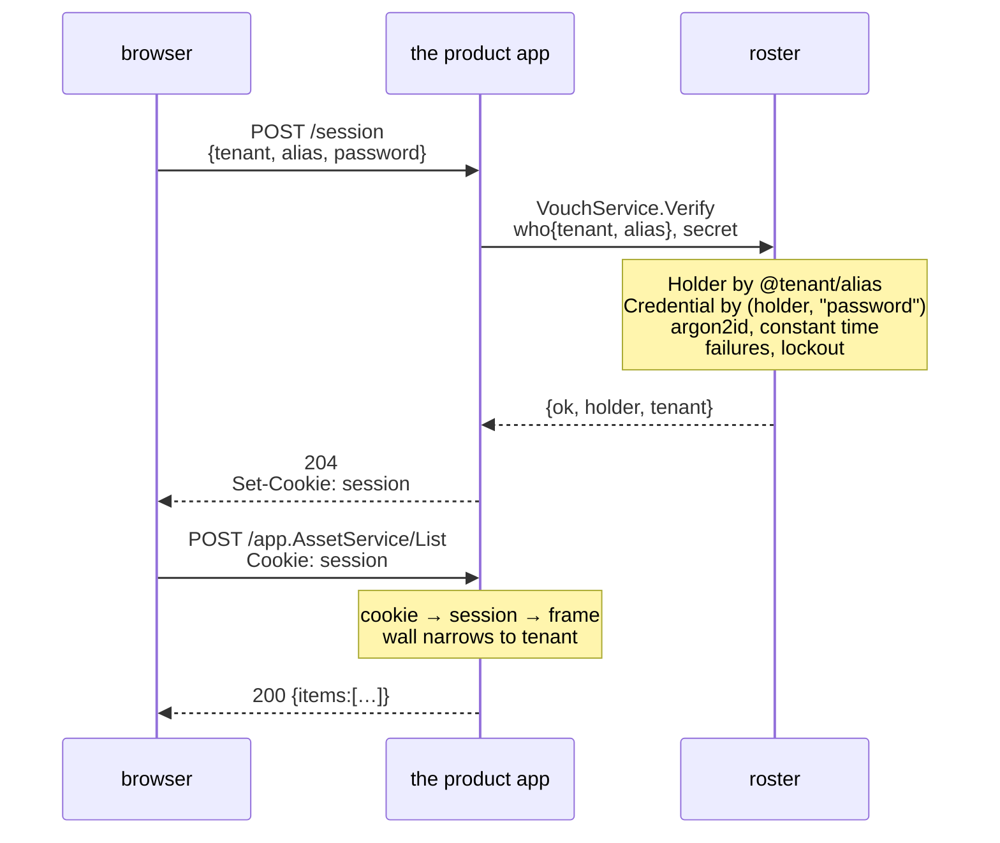
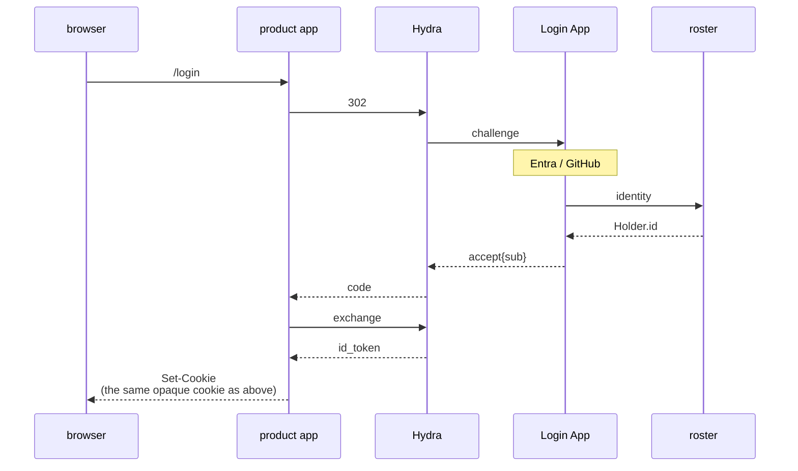
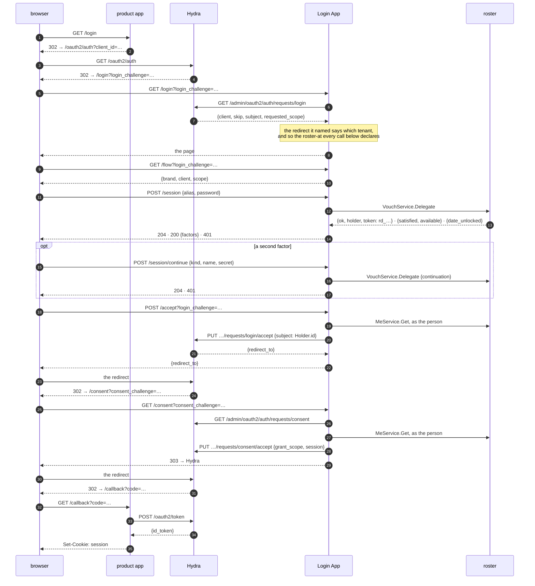
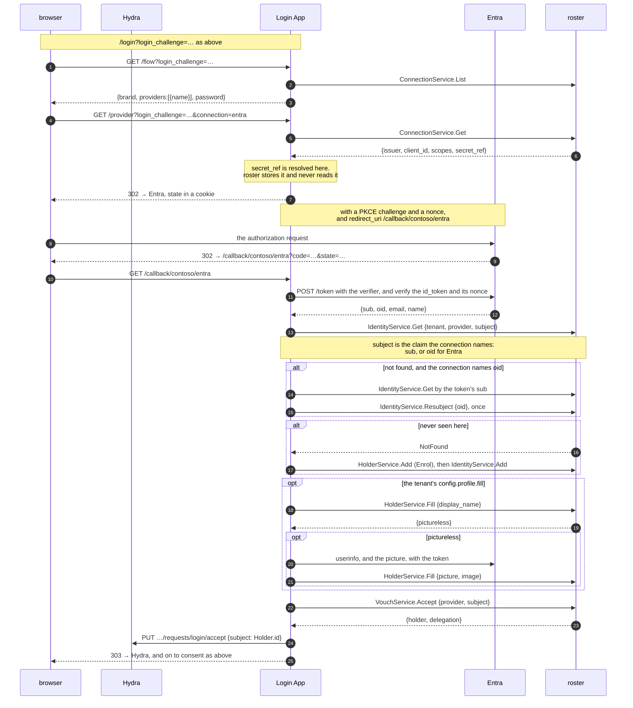
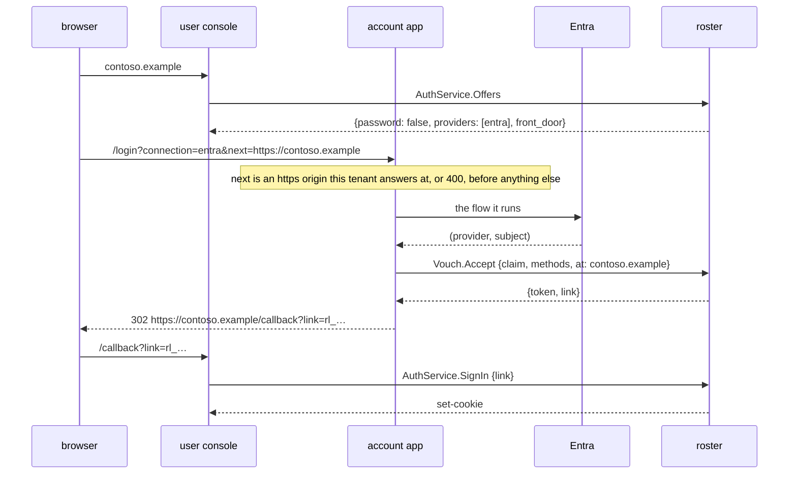
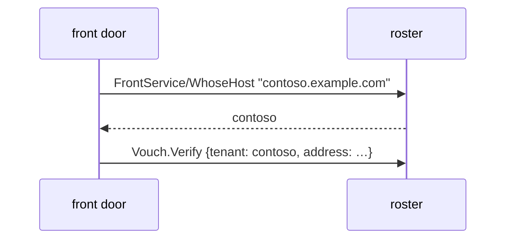
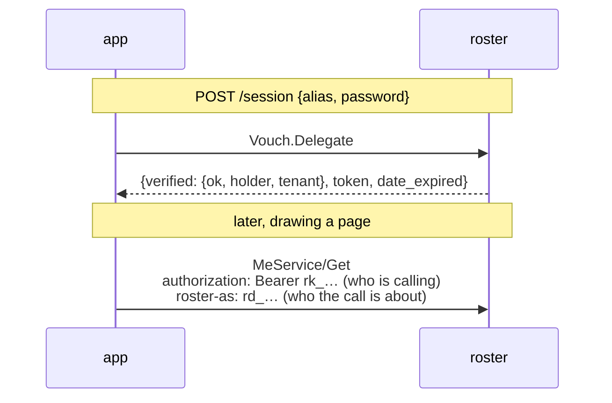

# Signing in

What happens when somebody types a password, end to end, and the HTTP contract a
sign-in page of your own is written against.

Four things in this repository do this for real, and they are the detail behind
every picture below: `login/` is the Login App (`roster login serve`), `account/`
is the front door a customer's own people arrive at, `examples/sso` is a product
app that signs somebody in and reads its own record back, and `examples/product`
is a product app in front of Hydra. `docker/flow.sh` walks the first through a
real Hydra; [relying-party.md](relying-party.md) is the last two.

## Two directions, and one word for both

*Single sign-on* is said of two different things here, and they face opposite
ways.

```
arriving   Entra ────▶ a front door ────▶ roster

           a tenant's own people sign in with the directory their tenant
           already has. The front door is the relying party at Entra, and
           `Connection` is the row that says which.

leaving    roster ────▶ the Login App ────▶ Hydra ────▶ the products

           this deployment's own products share one sign-in. Hydra is the
           issuer, and the Login App tells it who.
```

Neither direction is roster's to walk. In the first, somebody has to hold the
tenant's client secret and check Entra's signature, and `connection.proto` says
that somebody is not roster. In the second, somebody has to sign what the
products verify, and [position.md](position.md) says that somebody is Hydra.
What roster does in both is answer *who is this*, once, and own the answer.

The account app walks the first and never the second. The Login App walks both,
because a browser Hydra sent it may still arrive through a directory. § *The user
console, through the front door* is the first direction seen from the user
console, which cannot walk it either and sends the browser to the front door
instead.

## One app, or several

**One app: you do not need Hydra.** The picture below is complete, and nothing is
signed.

**Several apps, one sign-in: you do.** An app's cookie means nothing to the next
product, and the thing that fixes it -- a credential with an issuer, a JWKS
endpoint, expiry, refresh and revocation -- *is* OIDC. Writing it yourself is
writing Hydra.

So the question is never *password or OIDC*. It is **one relying party or many**,
and an air-gapped single app needs neither. [position.md](position.md) § "Single
sign-on does not make roster bigger" is the same decision from roster's side.

## The path, without Hydra



**roster never sees *this* browser.** The data plane is called by machines, and
the session is the app's, because a cookie belongs to the origin the browser is
actually talking to.

roster does serve browsers of its own -- the admin console, on the control
plane, and the user console (§ *The user console, through the front door*), on a
cookie roster mints and checks (`AuthService.SignIn`). Neither is a product's,
and nothing about a product's sign-in passes through them.

### What each side answers

| | |
| --- | --- |
| `POST /session` → **204**, no body | The cookie is the answer. What a page needs *about the person* is a request it should make, against the same server and behind the same wall |
| `POST /session` → **401** | Wrong password, unknown person, no such tenant -- one answer for all of them |
| `Vouch.Verify` → `{ok:false}` | Same, and it takes the same time |
| `Vouch.Verify` → `{date_unlocked}` | Too many wrong answers in a row closed the account for a while -- ten and fifteen minutes unless `vouch.lockout` says otherwise |
| `DELETE /session` → **204** | The row is deleted, so the key is dead in every browser at once |
| any RPC → **401** | No cookie, a cookie naming nothing, an expired session, or a session naming somebody since erased |

**Every refusal looks the same on purpose.** An unknown person, a person with no
password and a wrong password are one answer, and the first two burn an argon2
comparison so that they take as long as the third -- otherwise the response time
answers *does this account exist*, which is the question somebody working through
a list of addresses is asking. The one refusal that is distinguishable is a
lockout, which is a deliberate trade: it says the person exists, and the
alternative is somebody locked out being told nothing and trying forever.
`server/vouch`'s package comment has the rest, including what a lockout does
**not** fix.

### The app's session, and what is in it

Worth being exact, because *session* is a word people fill in differently and the
mechanism decides what is possible afterwards.

payday's answer is `auth/authsession`: the cookie's value is **32 bytes from
`crypto/rand`**, base64url, and it is a **handle** -- not a token, not a hash of
one, carrying no claims, no signature and no expiry a client can see. What it
handles is a row in the app's own store holding the actor, the tenant, a
`frame.Grant`, an absolute expiry and an idle one. A key naming no row is simply
not a session.

Two consequences follow, and both are the point:

- **Signing somebody out is a delete**, immediate everywhere that cookie was
  used. There is nothing to wait out.
- **The cookie is worthless to any other app.** It names a row in this app, and
  the next product has no such row -- which is exactly what Hydra is for, one
  section down.

Nothing about the person is copied into the row, so a session cannot be a stale
copy of somebody: the name, the teams and the permissions are read when there is
a screen to draw. And an app holding a session keeps **no password** -- the
plaintext passes through its process on the way to roster and is written nowhere.
An app that wants a row of its own for the people it has seen makes it on the
first call *after* signing in rather than at sign-in, so `date_created` there
means *first seen here* rather than *signed in once*; roster's name for the same
person is deliberately not copied, because that copy would be wrong the first
time somebody marries.

## What changes when Hydra is in front

Less than it looks like, and **roster does not get smaller** -- Hydra has no user
database and authenticates nobody. It hands a `login_challenge` to a Login App
and waits to be told a `subject`, and choosing that string is the problem roster
exists for.



Line by line, against the no-Hydra picture:

| | without Hydra | with Hydra |
| --- | --- | --- |
| who asks roster | the product app | the **Login App** |
| what it asks | `VouchService.Verify` | `Identity` → `Holder.id` and then `Vouch.Accept`, or `Vouch.Delegate` for a password |
| what the product app gets back | `{ok, holder, tenant}` | an `id_token` carrying the same `sub` |
| the cookie | the app's own, opaque | **unchanged** -- the app's own, opaque |
| a second product | has to sign in again | is already signed in, at Hydra |

The token is used **once**, at the callback, to find out who this is. It is not
stored, not compared on later requests and not given to the browser -- there is
nowhere safe in a browser to keep one. After that, the picture is the one at the
top of this page, so the app-side code barely moves: `authsession` asks for a
`Verify` either way, and what changes is what fills it.

**roster ships the Login App**: `login/`, run as `roster login serve`. It reads
the challenge, draws the same `frontdoor` forms **and the operator's providers**,
and answers `acceptLoginRequest{subject}` with a `Holder.id` either way. The
consent hop then reads the person once, *as them*, and puts `preferred_username`,
`name`, `teams`, a **verified** address and -- for a relying party that grants on
names -- the `groups` shown to that client into the `id_token`, each only if the
client asked for the scope that carries it. What it never puts there is `methods`
-- roster's answer about roster, which a product holding a copy of would hold a
stale one.

Which tenant a flow belongs to comes from the **redirect the authorization
request named**, read out of the challenge over Hydra's admin API and resolved
through that tenant's own `Host` row. Not the hostname the browser arrived at:
Hydra has one `urls.login` for the whole issuer, so every flow lands here under
one name and the arrival host says nothing about anybody.

What a name resolved to is **remembered a minute**, as the account app
remembers one, and then asked about again: which tenant it is, and that
tenant's alias and what it is called. So a name that moved to another tenant
signs that tenant's people in within a minute, and a tenant whose alias or name
changed is addressed and drawn by the new one, with no restart. It was kept for
the life of the process, and a changed alias was every password of that tenant
refused until one (`TestATenantsNewAliasSignsItsPeopleInOnceAMinuteHasPassed`,
`TestANameThatMovedSignsInTheTenantItMovedTo`). A round trip to a provider that
was already under way is finished as the tenant it began with, which is ten
minutes at most.

It was the OAuth **client**, through a map this app was configured with
(`login.clients`), and that had to go: one product serving a hundred tenants is
one client, so a discriminator that is the client forces a Hydra registration per
customer -- for a fact roster already holds. Several clients per tenant still
reach one sign-in, because one sign-in across two products is the case Hydra is
for at all; they resolve here through the redirect each names rather than through
a list.

A browser picks its `redirect_uri` from the set its client registered, and Hydra
refuses anything else -- so what picking another tenant's buys is nothing: the
password is then checked against that tenant's holders, at a front door that is
public anyway. A client whose redirects are several tenants' is the product the
paragraph above is about, and each of its flows is about the tenant whose
redirect it named. `roster login doctor` says so and fails no run for it; it
used to report that client as broken, which was the check saying the opposite
of this page. What it leaves to the product is telling its tenants apart, by
the redirect, because a token says nothing of the tenant (§ *What a token says
of somebody*). The one such client that is broken is one that can do the device
grant: a device flow names no redirect, so of two tenants' it is about neither
(§ *A device with no browser*).

**A command line** that signs somebody in through their browser redirects to
the loopback interface on whatever port it could open,
`http://127.0.0.1:<port>/callback` (RFC 8252 §7.3), and that address is the same
on every machine and in every tenant: it **says nothing about the tenant**. A
loopback redirect -- `http`, at the IP literal `127.0.0.1` or `[::1]`, any port,
any path -- is read as a flow that named no redirect, and the client's
registration answers, with its one host that is not a loopback address. So a
command line's client registers its loopback address **beside** a redirect at
the tenant's own host, which nothing redirects to and which is what says whose
it is:

```json
"redirect_uris": ["http://127.0.0.1/callback", "https://contoso.app.example/callback"]
```

What Hydra (v26.2.0) asks of the registration for **any port** to match is a
registered redirect with the same IP literal, path and query as the request's:
it leaves the port out of the comparison on both sides, so `http://127.0.0.1/callback`
matches `http://127.0.0.1:53117/callback`. `127.0.0.1` and `[::1]` are two
registrations, for a command line that listens on either. `localhost` is not a
loopback address here -- RFC 8252 §8.3 tells a native app not to use it, Hydra
compares it exactly, and it is a name, which a tenant can claim with a `Host` row
and is then that tenant's like any other. A client of loopback addresses alone
names no tenant and every flow of it is refused, saying so; and with two
tenants' hosts beside them it is two answers, as without them. `roster login
doctor` counts no loopback address as a tenant's, so a client of one tenant's
host and loopback addresses passes, device grant or not, and one of loopback
addresses alone is reported broken (`TestACommandLinesLoopbackRedirectIsTheTenantItsClientRegistered`,
`TestDoctorCountsNoLoopbackAddressAsATenant`).

The consent hop **grants what the client asked for and draws nothing**, which is
`consent: skip`, the default and a decision: every client this app can have was
registered by the deployment for one of its own operators, and a screen for an app
the operator wrote is a dialog people learn to click through. `consent: ask` draws
one. Neither mode lets a person grant *less* than was asked -- an app that asked
for a scope generally stops working without it, so the choice would be between
*allow* and *allow, then find out something is broken*. And a **device's** flow
is drawn the screen under either: what brings a browser to it is a code, not a
client's redirect, and the consent is the first screen that can say whose device
it is (§ *A device with no browser*).

How a deployment turns it on is [operating.md](operating.md) § "One process, or
five"; `compose.yaml` runs the whole of it, Hydra included.

### Every hop, and the call it makes

The picture above is the shape. This is the wire: every redirect, every endpoint
and every RPC, in order, for the two routes that reach a `Holder.id`.

Both are the Login App's, and both are the account app's -- the two front doors
draw the same forms over `ts/lib/signin.tsx` and are the same relying party over
`arrives`. What differs is the ending: the account app finishes at its own cookie,
and this one finishes at `acceptLoginRequest{subject}`. What the two routes share
is the last fact and nothing else, which is the point: the `sub` a product sees
names the same person whichever door they came through. roster is the relying
party in neither -- `connection.proto` says why.

#### A password, with Hydra in front



| | the call | what it settles |
| --- | --- | --- |
| the challenge | `GET /admin/oauth2/auth/requests/login` | which **client**, and the redirect it named -- whose host is the tenant (§ *What a front door needs*). Asked before a form is drawn, so a challenge this app fronts nobody for fails here rather than after somebody has typed a password |
| `skip` | `MeService.Get`, as the person | Hydra already knows this browser, within `remember`. `acceptLogin(v.Subject)` straight away **if this app can still read that person** -- its session is there, its delegation is alive, and it is the subject's. The subject is Hydra's and this app does not second-guess it; what it checks is that the consent hop will be able to fill the claims. Otherwise the form, as if Hydra remembered nothing, and `login_required` for a client that asked for `prompt=none` |
| the page | `GET /flow` | `{brand, client, scope}`. The page may not ask Hydra and this app may, so this is the one endpoint it has |
| the first form | `VouchService.Delegate` | 204 signed in · 200 one factor proved, another to prove · 401 everything else. `Delegate` and not `Verify` because a yes has to come back with the `rd_` the consent hop reads `Me.Get` with |
| the second form | `VouchService.Delegate` with the continuation | the app holds no half-signed-in state: the continuation is roster's, short-lived and single-use |
| the accept | `MeService.Get`, as the person; `PUT …/login/accept` | **`subject` is the `Holder.id`.** Nobody is named until every form is answered -- accepting after the first would hand a product a token for somebody who proved half of what the deployment asked for. And nobody is named but **the sign-in made at this challenge, still standing**: the session answers the challenge its form was posted at and no other, in that challenge's tenant, and roster is asked who is there before Hydra is told -- signed out of, signed out everywhere or suspended is a 401 and Hydra hears nothing (§ *The last hop answers the sign-in made for it*) |
| the claims | `MeService.Get`, as the person | `preferred_username`, `name`, `teams`, a **verified** address, `groups` -- each only if the client asked for the scope that carries it, and each as § *What a token says of somebody* says. Never `methods`. `teams` is the aliases of the person's teams -- an organisation's structure, and nothing a product should grant on. It was `groups`, which relying parties read as permission groups; roster's own `Group`s are in a token only as `groups`, and only the ones a `GroupExposure` shows to the client the token is for (§ *A relying party that grants on groups*) -- what somebody may do is otherwise `HolderService/Reaches` ([apps.md](apps.md)) |
| the grant | `PUT …/consent/accept` | `consent: skip` grants and draws nothing; `ask` draws the screen and `POST /consent` is its answer, told `{redirect_to}` as the accept is. A device's flow is drawn the screen either way. With nobody here to read the subject -- a session that ended between the hops of one flow, or somebody signed out everywhere or suspended between them -- the client is refused with `login_required` (`PUT …/consent/reject`) rather than granted `sub` alone, **whatever it asked for**: the read is also how this hop knows the subject is still somebody |

The delegation this app minted is **kept** after the grant, for as long as Hydra
remembers the browser, because the next flow Hydra answers without a form reads
the claims with it (§ *The app's own session, and why it is not shorter*). Only
where `remember` is zero is it spent at the grant: the cookie is ended there and
the delegation revoked at roster (`Door.End`), since no later flow comes back for
it, and a credential that outlives its use is one somebody has to remember to
revoke. A sign-out through the issuer ends both the same way (§ *Signing out
reaches the issuer*).

#### An account at a provider, with Hydra in front

The same walk with the two forms replaced by a round trip. Everything after the
identity is the password path's last three hops, unchanged.



| | the call | what it settles |
| --- | --- | --- |
| the buttons | `ConnectionService.List` | what `/flow` answers beside the brand. The **name** and nothing else: the issuer is where the browser is about to go, `secret_ref` is the operator's, and what to call the button is the page's |
| a product's own buttons | `request_url`, and `ConnectionService.List` | a product whose sign-in screen is its own names the button somebody pressed as `connection=<name>` on the authorization request. Hydra keeps the request whole and ignores the parameter, so `GET /login` reads it there and answers with a 303 to `/provider` for that connection instead of the page. A name the tenant has no connection by is the page, which lists what there is: a hint, not an order, and only ever one of the tenant's own |
| the form | `TenantService.Get`, `config.password` | whether there is a password form at all. Not a screen setting: roster **refuses** a password for a tenant with this off (`vouch.Offers`), so the page draws what is already true. Unset is yes |
| which operator | the challenge, again | `/provider` is in a flow, so the `Connection` rows read are the ones the tenant behind the redirect can see -- the call is narrowed to the holder that tenant nominated. fabrikam's challenge cannot reach contoso's directory |
| the redirect | `login.base` | **one origin for the whole app**, because Hydra sends every browser here under one name, and **one path per connection** under it: `<base>/callback/<tenant>/<connection>`, which is what a deployment registers at that provider. Which flow a callback belongs to comes from the state, a nonce naming a row this app kept; the path has to name the connection that flow went to, so a provider's code can only come back through its own connection's door -- one URL for every connection let a server of one tenant's send a browser on to another's provider and be handed the code that came back (a mix-up, RFC 9700 § 4.4) |
| the round trip's own checks | `arrives.Trip` | a **PKCE** challenge (S256) on every connection, whose verifier the exchange sends, so a code injected into somebody else's browser is refused by the provider itself; and on an OpenID connection a **nonce**, which the ID token has to carry back. GitHub issues no ID token, so it has the first and not the second |
| the exchange | the provider's own | the Login App is the relying party, exactly as the account app is. Where the connection's row says the provider is, which is asked only at an address on the internet, and only over `https`, unless the deployment named the host (`login.private_hosts`; [operating.md](operating.md) § *Where a provider is asked*) -- and the issuer the row names now, with no restart when it moves |
| who may sign in | `login.enrol`, `HolderService.SignsIn` | `invited` admits only somebody already linked; `expected` admits somebody an operator entered, matched by the **address** on their row; `enrolling` admits a stranger too, named by their address where the directory says it is verified and by a name nobody chose where it does not. An address matches only when it is **proved**, or is an **invitation** -- written by somebody other than the person (`Email.entered_by`), vouched for by no directory, about somebody with no identity, credential or key yet, which `SignsIn` says. An address somebody wrote onto their own account, or a directory handed over unchecked, matches nobody: it would hand whoever arrived verified at that mailbox to the account that claimed it first. **Somebody matched who holds more than this app is not linked by it**: the first link is a way in written by the app, which writes none for anybody who holds what its own role does not -- so somebody entered and given a role is answered `403`, *an administrator of your organisation has to link it for you*, until one does, or links them ahead where the connection's subject is one an administrator knows (§ *Putting people in, and letting them arrive*). **Somebody erased is neither signed in nor made again**, under any of the three: their account and the address they proved are theirs until they are forgotten, and arriving by either they are answered `403`, *this account was deleted here*, until they are brought back or let go (the same section). `enrolling` needs `HolderService.Add`, which `roster login provision` puts on the nominated holder's role and never on the key |
| what the profile lacks | the tenant's `config.profile` | `fill` gives the profile what its source says where it has **nothing**: a display name, and a picture for somebody with none. The source is the provider -- the token's `name` and `picture`, else userinfo's, the picture fetched with the token from the provider's own API (Entra's needs `User.Read` among the connection's scopes, consented for the directory first) -- or, where the deployment named the tenant's Slack workspace, Slack's real name and the picture the person chose, found by their address where the directory says it is verified. [operating.md](operating.md) § *A picture from the directory*. Only blanks, through `HolderService.Fill`, which writes nothing over a value and reads nothing back. Never a reason to refuse the sign-in |
| the sign-in | `VouchService.Accept` | the claim this app verified, exchanged for a delegation. Not `Verify`: there is no password here to check |
| the session | `Door.Accept` | minted here for the same reason the password path has one -- the consent hop reads the person **as them** to fill the claims |
| the accept | `PUT …/login/accept` | the `Holder.id`. The same string a password would have produced for the same person, which is what makes Monday-Entra and Saturday-password one `sub` |

**The account app is the same walk with no Hydra**, and it is the shape a
deployment with one relying party should still take: same package, same policy,
two different ends -- the tenant comes from the **host**
(`FrontService.WhoseHost`, so there is a redirect per tenant rather than one for
all of them), and it finishes at the app's own cookie.
`account/account.go`'s `login`/`callback` and `login/provider.go` are the two
endings; everything between them is `arrives`.

And the other direction is done: **signing somebody out in roster reaches
Hydra.** The Login App holds `SyncService` open -- one stream, on its deployment key and naming no tenant, so it hears every tenant's sign-outs, fronted or not -- and when
roster says somebody has been signed out everywhere, suspended or erased it tells
Hydra to forget them -- so the next product they open finds a form rather than a
fresh token. **Every client's grant goes with the browser**: a refresh token
hangs off what somebody granted a client, not off the browser, so a product
holding one refreshed on after a sign-out that only forgot the browser. An
access token already issued is not reached -- a JWT verifies until it expires.
roster does not know Hydra exists and this does not change that: the
stream says what has stopped being good in roster's own vocabulary, to any app
holding a credential, and turning that into a `DELETE` is the Login App's. What
it also says -- that what somebody may call may have changed, `SYNC_REASON_REACH`
-- is no sign-out, and tells Hydra nothing (`TestWhatSomebodyMayCallIsNoSignOut`).

**What is promised of it, and what is not.** The stream replays nothing, so the
promise has two halves: what an instance heard, and what none did.

- **A sign-out an instance heard is carried until Hydra takes it.** What the
  stream says is written down and a worker tells Hydra, each call given ten
  seconds; one Hydra refuses or does not answer is tried again -- after a
  second, doubling to half a minute -- for as long as the process runs
  (`TestASignOutHydraWouldNotTakeIsTriedUntilItDoes`). What is still owed when
  the process stops is not handed to the next one: it is then a sign-out nobody
  heard, below.
- **Once.** A sign-out carried is not carried again because a stream dropped
  and came back (`TestAStreamThatCameBackSignsNobodyOutAgain`), and a new
  process does not act on a stamp from before it could have missed anything
  (`TestASignOutActedOnLongAgoIsNotActedOnAgain`). It did both, and the first
  write of any kind to a person's row after a restart -- a profile edit, a
  directory's sync -- signed them out of every product for a sign-out made
  months before.
- **A sign-out nobody heard is carried only if the gap was short.** One made
  while no instance was listening is known by the stamp on the person's row and
  nothing else, and an instance is sent that stamp when the row is next
  written, whenever that is. It acts on a stamp it had not heard when the stamp
  is no older than **ten minutes before that instance started**
  (`TestASignOutMadeWhileNobodyListenedIsCarried`) -- long enough for a
  rollout, and what somebody signed out inside it pays is being signed out once
  more. **A sign-out made while no instance listened for more than ten minutes
  is not carried to Hydra.**
- **A browser Hydra still remembers is asked for the form all the same.** That
  Hydra knows a browser is believed only where roster still reads the person
  behind it, which the app asks at every flow
  (`TestABrowserThisAppForgotIsAskedAgain`), and roster stops reading them the
  moment they are signed out everywhere, suspended or erased. So a browser
  Hydra remembers past a sign-out it never heard of is drawn the form.
- **What it leaves is a refresh token.** A grant Hydra was not told to revoke
  goes on refreshing until the token's lifetime, which is the issuer's to set
  -- `ttl.refresh_token`, or a client's own
  `authorization_code_grant_refresh_token_lifespan` and
  `refresh_token_grant_refresh_token_lifespan` -- and **no registration this
  repository ships sets one** (`deploy/clients/product.json`, `compose.yaml`),
  so it is Hydra's default, which on v26.2.0 is thirty days. A deployment
  should set it, as short as its products can bear: it is the bound on
  everything above that is not carried.
- **A sign-in waits for the sign-out before it.** Hydra forgets by subject, so
  a forgetting that lands after somebody's next sign-in takes that sign-in with
  it. While one is on its way, Hydra is told of a sign-in by the same person
  only after it, for five seconds at most
  (`TestASignInIsToldToHydraAfterTheForgettingItFollows`). What that does not
  save is a flow Hydra began while it still remembered the browser -- a page
  that sent its browser to sign in in the moment between the sign-out and Hydra
  hearing of it: Hydra v26.2.0 refuses that flow's code (`invalid_grant`), and
  the flow after it works.
- **A stream roster refuses is asked for again.** No broker
  ([operating.md](operating.md) § *Running more than one*), or a key whose list does not
  name `SyncService/Watch`: the app says so once, as an error, goes on signing
  people in, asks again every ten minutes, and says when roster serves it
  (`TestAStreamRosterRefusesIsAskedForAgain`). Until then it hears nothing, and
  everything it would have heard is a sign-out nobody heard.

### A page of your own, and the contract it writes against

The page in `ts/login/` is **one implementation** of the surface below, not the
surface. A deployment that wants its own sign-in screens builds them and points
`login.page.dir` at the result; one that serves them from its own static server
leaves the setting out and keeps the endpoints. Under one constraint that is not
negotiable: **this app sends no CORS headers**, so the page has to reach
`POST /session` and `POST /accept` as **same origin** -- in practice a proxy
putting the page and this listener under one name.

**And it takes nothing that changes something from any other origin.** Every
`POST` below, and the `DELETE`, is answered 403 when the browser says the request
is another origin's -- `Sec-Fetch-Site`, or `Origin` against `Host` for a browser
that does not say -- so that proxy passes those three headers as the browser
wrote them. Another host of the same domain is another origin, which a cookie's
`SameSite` does not stop; and most of these routes need no cookie at all. A
request that says neither header is not a browser's and is let through. No
screen is drawn inside another site's (`frame-ancestors 'none'`). It is the
account app's rule and the same wrapper, `frontdoor.Guard`
(`TestTheLoginAppsOwnRoutesTakeNoRequestFromAnotherOrigin`).

⚠️ **Empty means this binary serves no page at all**, and what a browser gets at
`/login` is a **404** with *this deployment serves no sign-in page*. It looks
exactly like the issuer being broken, and the two ways to arrive at it are
forgetting the setting and pointing it at a directory that was never built.

Which makes this a contract rather than an internal shape, and it is written down
because there are **four** implementations of it in this repository -- the real app
and the made-up server in `ts/vite.login.ts` on one side, `ts/lib/signin.tsx` and
`frontdoor/web/frontdoor.js` on the other -- and nothing had said what they were
all implementing. To write one against nothing, `npm --prefix ts run dev:login`.

Every pattern below is mounted by `App.Handler()` (`login/login.go`), except the
three marked `frontdoor`, which are `Door.Handler()`'s and are the same three the
account app serves. `login/contract_test.go` fails when this table and those two
functions stop agreeing, in either direction.

| mounted as | what it promises a page | pinned by |
| --- | --- | --- |
| `GET /login` | the first screen, as a document. Hydra's own `skip` is answered here instead, with a 303 and no page drawn, when this app can still read the person Hydra remembers -- and with the page when it cannot, or a 303 carrying `login_required` for `prompt=none`; so is an authorization request that named one of the tenant's connections (`connection=`), with a 303 to `/provider` for it | `TestALoginAppTellsHydraWhoSignedIn` · `TestASecondFlowCarriesTheClaimsToo` · `TestABrowserThisAppForgotIsAskedAgain` · `TestAFlowThatNamesAConnectionGoesStraightThere` |
| `GET /flow` | `{brand, client, scope, providers, password}` for a login challenge, `{brand, logout}` for a logout one. **The only thing a page may ask**, because what a flow is about is Hydra's to say and only this app may ask Hydra | `TestATenantWithNoPasswordDrawsNoForm` · `ts/e2e/login.spec.ts` |
| `/session`, `/session/` | mounted so `frontdoor`'s three below see the whole path. One handler, three methods | `TestALoginAppTellsHydraWhoSignedIn` |
| `POST /session` | *frontdoor.* `{alias\|address, password}` → **204** signed in · **200** `{satisfied, available}` one factor proved and more to prove · **401** everything else | `TestALoginAppTellsHydraWhoSignedIn` · `TestASecondFactorIsAskedForAndTheFlowWaitsForIt` · `TestARosterThatIsDownIsNotAWrongPassword` |
| `POST /session/continue` | *frontdoor.* `{kind, name, secret}` → **204** · **401**. One attempt per first form: the half-session is spent whether the answer was right or not | `TestAWrongSecondFactorFinishesNothing` · `TestAHalfSessionIsOverWhenTheAppSaidItWas` · `TestASignedInBrowserSurvivesAStraySecondForm` |
| `DELETE /session` | *frontdoor.* Drops this app's session and revokes the delegation, in the tenant the session is of. Not part of the flow -- the flow's own ending is `POST /accept` -- and mounted because it is the same handler | `TestSigningOutRevokesEvenAWindowThatHasPassed` · `TestASessionIsEndedInItsOwnTenant` · `TestEveryEndingRevokesTheDelegation` |
| `POST /accept` | `{redirect_to}`, and **the hop no other front door has**: it turns a finished sign-in into `acceptLoginRequest{subject}`. A page that leaves this out signs somebody in and never ends the flow. 401 when nobody is signed in, or is half way; when the sign-in was not made at **this** `login_challenge`; and when roster no longer answers for whoever it was | `TestALoginAppTellsHydraWhoSignedIn` · `TestAFlowReachesOnlyItsOwnOperator` · `TestASignInAnswersOnlyTheChallengeItWasMadeFor` · `TestASessionOfOneTenantDoesNotAnswerAnothersChallenge` · `TestAnAcceptAsksRosterWhoIsThere` |
| `GET /provider` | 302 to the directory this operator's `Connection` names, with the state in a cookie that is this host's alone (`__Host-login_state`; bare under `--insecure-cookie`) | `TestSomebodyArrivesThroughAProvider` · `TestAProviderFlowReachesOnlyItsOwnOperator` · `TestTheRoundTripsCookieIsThisHostsAlone` |
| `GET /callback/{tenant}/{connection}` | where a directory sends the browser back: one URL per connection, which is what is registered at that provider. **Not** in a flow: which flow it belongs to comes from the state, and the connection the path names has to be the one that flow went to | `TestACallbackWithoutItsOwnStateIsRefused` · `TestAnAnswerIsHeldToTheRoundTripThatAskedForIt` · `TestAStrangerIsRefusedUnlessTheDeploymentEnrols` |
| `GET /consent` | a screen when `login.consent` is `ask`, a 303 when it is `skip` or Hydra remembered -- to Hydra with the claims, or carrying `login_required` when there is nobody here to read the subject as. **Always a screen for a consent that belongs to a device's flow**, which nothing before it could name the client of | `TestTheConsentScreenIsDrawnWhenTheDeploymentAsksForOne` · `TestATokenIsNotHandedOutWithoutTheClaimsItAskedFor` · `TestAConsentWhoseSubjectCannotBeReadIsRefused` · `TestADeviceIsGrantedOnAScreen` · `docker/device.sh` |
| `POST /consent` | the screen's answer: `{consent_challenge, allow}` → `{redirect_to}`, which is Hydra -- with the grant, or with a refusal for the client where the answer was a no (`consent/reject`) or this app refused. **Told, not redirected**, as `POST /accept` is: the issuer is another origin and a page's `fetch` cannot follow a redirect to one | `TestAConsentIsAnsweredWhereThePageCanFollowIt` · `TestTheConsentScreenIsDrawnWhenTheDeploymentAsksForOne` · `ts/e2e/login.spec.ts` · `docker/flow.sh` |
| `GET /logout` | a screen only half the time: drawn when nothing proved a relying party started the sign-out, answered with a 303 when something did. With that 303 this app's own session is ended and its delegation revoked, when the logout is about whoever this browser is signed in as here | `TestALogoutNobodyProvedAnAppAskedForIsConfirmed` · `TestSigningOutEndsWhatTheIssuerRemembers` · `TestEveryEndingRevokesTheDelegation` · `TestASignOutEndsOnlyItsOwnSubjectsSession` · `docker/behind.sh` |
| `POST /logout` | `{logout_challenge, allow}` → `{signed_out, to}`, or `{signed_out: false}` and nowhere to go. **400 for a logout an app did prove it started**, because that one is never drawn | `TestTheConfirmedSignOutIsTheOneThatEnds` · `TestTheAnswerIsForTheScreenThatWasDrawn` · `TestALogoutChallengeIsAskedAbout` |
| `GET /signed-out` | the page a sign-out that asked to come back nowhere ends on. The one screen here with no challenge on it | `docker/behind.sh` · `ts/e2e/login.spec.ts` |
| `GET /device` | where somebody types the code a device with no browser printed. **The one screen that asks the app nothing** -- Hydra has no getter for a device challenge, so there is no `/flow` for it and no client name to draw | `TestADeviceChallengeIsAnsweredWithWhereToGoNext` · `docker/device.sh` · `ts/e2e/login.spec.ts` |
| `POST /device` | `{device_challenge, user_code}` → `{to}`, which is Hydra, which comes back as an ordinary login challenge. **400 for a code Hydra refused**, one answer for never issued, already used and expired | `TestEveryWrongDeviceCodeIsOneAnswer` · `docker/device.sh` · `ts/e2e/login.spec.ts` |
| `/` | the build, and its assets. `/login`, `/consent`, `/logout`, `/device` and `/signed-out` are rewritten to `/` rather than redirected, so a page is **one document** that reads which screen it is from the challenge in its own URL | `docker/itself.sh` · `ts/e2e/login.spec.ts` |

And the rules, which are the part that is easy to get wrong and the reason
`frontdoor/web/frontdoor.js` exists at all:

- **Three answers where a page expects two.** 204, 200 and 401 -- and the 401 is
  one answer for a wrong password, an unknown person, somebody with no password
  and a tenant this deployment does not serve. roster took care to make those one
  answer; a page that tells them apart undoes it.
- **Never draw the second form from anything the server called it.** roster answers
  what is `satisfied` and what is `available`; what to call a factor and which to
  offer is the page's. The field that would decide it here is refused on purpose.
- **The challenge rides in the query, and nothing believes it without asking
  Hydra.** It was a cookie for half an hour and could not be: Hydra's challenge is
  about two kilobytes against a four-kilobyte cap.
- **Hold nothing.** No token, no continuation, no idea how many steps there are.
  The cookie the app set is the whole of the state, so script on the page has
  nothing to reach.
- **The document is never kept.** `cache-control: no-store` is set for you on
  every screen; a stale copy is a browser posting to a challenge that has been
  spent. What the screen loads is another matter: the bundles beside it are
  named by their content and served `immutable`, like every other page's.
- **A screen's answer is a form of a few kilobytes.** `POST /consent`,
  `POST /logout` and `POST /device` read a form -- urlencoded, or the multipart
  a `FormData` is -- to sixteen kilobytes, which is a challenge and a word or
  two, and answer 413 to more (`TestAScreensAnswerIsReadToASize`).
- **An answer you do not recognise is a refusal, not a crash.** Two rows above
  gained a state after they were first written, and a page that draws *this did not
  work* for an unknown answer survives that. It is the one thing asked of a page in
  return for the table being a contract.
- **`POST /accept` may not be left out.** It is the hop that turns a finished
  sign-in into Hydra's answer; a page without it signs somebody in and leaves the
  flow hanging with nothing on screen to say so.
- **And it is called with the challenge the forms were posted with.** A sign-in
  answers the `login_challenge` it was made at and no other, so `/session`,
  `/session/continue` and `/accept` carry the same one: the one in the page's own
  URL.

### What a token says of somebody

One answer for each claim, which is what a product writes against. All of it is
in the `id_token`, each claim only for a client that asked the scope that
carries it; the access token carries nothing of roster's.

| claim | scope | what it is |
| --- | --- | --- |
| `sub` | `openid` | the `Holder.id`: one person of one tenant, and nobody else in the deployment. It does not change when they are renamed, when their alias changes, or with the way they signed in |
| `preferred_username` | `profile` | their alias, as it is now. One person's within their tenant, and somebody else's to take once it is changed or its holder erased |
| `name` | `profile` | what they are called now: their profile's display name, and where that is blank the name they were added with. Absent for somebody with neither |
| `teams` | `profile` | the aliases of the teams they are in, each once and in order. The site is not said, so a team of one name at two sites is one word. Absent for somebody in none |
| `email`, `email_verified` | `email` | the address they **proved first**, of the ones they still have: the earliest `Email.date_verified`, and of two stamped at one instant the row written first. Proving another address does not change it, and nor does proving it again -- a link confirmed a second time, a directory vouching for it at each sign-in -- since a proof of an address already proved leaves the moment it was first proved; erasing it makes the next one proved the answer, and an address erased and written again is proved anew. An address nobody proved is never said, so `email_verified` is never false, and somebody with none proved has neither claim |
| `groups` | `groups` | the aliases of their groups that are shown to this client, in order; present and empty when none is (§ *A relying party that grants on groups*) |

**Every claim is a copy, made when consent is answered.** The person is read
once, at the consent hop -- of every authorization flow, the ones Hydra answers
with no form and no screen included -- and Hydra keeps what it was handed beside
the grant. A refresh mints from that copy and reads nothing of roster's again.
So a change to somebody reaches a product at their next flow through the
authorization endpoint, and what it does to a refresh token already issued is:

| what changed | a refresh token already issued |
| --- | --- |
| they were suspended or erased, signed out everywhere, or their tenant closed | **ended**. The Login App hears it and has Hydra revoke every client's grant for them -- *signing somebody out in roster reaches Hydra*, above |
| a group or a team was taken from them, or given; a group of theirs was erased | mints on, with the `groups` and `teams` of the last consent. roster says only that what they may call may have changed (`SYNC_REASON_REACH`), which is no sign-out and tells Hydra nothing |
| a group stopped being shown to the client; an address was proved, erased or moved; their alias or their name changed | mints on, with the old claims. Nothing tells the Login App |

An access token already issued verifies until it expires, in every row. And no
registration this repository ships sets a refresh lifetime
(`deploy/clients/`), so how long a copy can go on being minted is the issuer's
own default: a relying party that grants on a claim has its client registered
with a short one.

**Every claim but `sub` is the tenant's own word.** One issuer signs for every
tenant, and nothing in a token says which tenant its person is of.
`preferred_username` is one person's within a tenant and so is an address:
contoso and fabrikam can each have an `erin`, and each somebody at
`erin@example.com` with `email_verified: true`, because an address is proved
to its tenant -- by a link a front door mailed for it, on the word of a
directory it connected, or by a key it lets mint such a link and spend it --
and is held against no other tenant's. `groups` and `teams` are names a
tenant's administrator chose. So a product that serves several tenants **keys
its accounts on `sub`**, and never on an address or a username read across
tenants. It tells its tenants apart by the **redirect**: it registers one
`redirect_uri` for each, at a name that tenant claimed, a flow is about the
tenant whose redirect it named, and the code comes back to that redirect and no
other.

### A relying party that grants on groups

Some relying parties cannot ask roster what somebody may do: Dependency-Track,
kube-apiserver. They read a list of names out of the token and map each to
permissions of their own. For them the token carries `groups`:

- **Only for a client registered for the `groups` scope** -- in its Hydra
  registration, beside `openid` -- which Hydra refuses to grant to any other.
- **Only the groups shown to that client**: a `GroupExposure` naming the group
  and the client's id, which a tenant's administrator writes
  (`roster group-exposure add`) -- held across the tenant, so somebody bound
  only in the group's site neither shows it nor takes it away. None of the
  person's other groups, whatever they are in.
- **Present whenever the scope is**, and empty when none of their groups is
  shown to the client, so that a relying party syncing its teams from the claim
  takes somebody out of the last one.

Who is in such a group is its managers' and the tenant's administrator's
([usage/permissions.md](usage/permissions.md) § *Its managers*), and what it
lets somebody do is the relying party's mapping, kept there. The claim is the
group's alias, which nothing over the wire renames -- a group's `Update` writes
its name and its note and never its alias, and `Patch` is closed -- so a
mapping written against it stays true.

**It is a copy, read at consent, as every claim is** (§ *What a token says of
somebody*). A refresh reuses it -- nothing recomputes a token's claims at a
refresh yet -- so a name taken away reaches the relying party at the next
sign-in. Dependency-Track re-syncs a person's teams at each
of theirs, which bounds it; for kube-apiserver, whose clients refresh, give the
client a short refresh lifetime in its Hydra registration. A suspension is
not this: the Login App hears it and has Hydra end the person's sessions and
grants, refresh included -- as far as *What is promised of it, and what is
not* goes, above: a suspension no instance was listening for leaves a refresh
token to live out its lifetime, which is the other reason to set one. A token
already issued verifies until it expires.

**kube-apiserver**: map the claim with a prefix
(`claimMappings.groups.prefix: "roster:"`), so that a group's name can never be
one the cluster gives meaning to on its own. roster's aliases cannot spell
`system:` anyway; the prefix keeps it so whatever an alias may hold later.

### The app's own session, and why it is not shorter

It lasts as long as `remember` -- the same clock Hydra skips the form on -- and a
minute more.

It was closed at the end of every flow, on a rule that is right in general: a
credential which outlives its use is one somebody has to remember to revoke. The
reading of *its use* was wrong. What the delegation in that session is for is the
**claims**, read as the person by `Me.Get` at the consent hop, and a browser Hydra
remembers comes back for those -- a second product, or the same one opened the next
morning. Closed at the redirect, every one of those flows found no session and
handed back a token carrying `sub` and nothing else.

⚠️ With `remember` set that is **most** of a deployment's tokens, and what it looks
like from a product is an opaque identifier where a name should be.

What makes the longer session affordable is what is in it. `login.Methods` is
`Me.Get` and nothing else, so the delegation reads that one person's own profile
and can do nothing else. It ends where every delegation does, at roster, with
`Holder.Invalidate` -- whether or not this app hears of it. What the app hears
through `Sync.Watch` is for Hydra's memory and not for its own: a browser Hydra
still remembers, after a sign-out that never reached it, is asked for the form
anyway, because the app asks roster at every flow (*What is promised of it, and
what is not*, above). And it has
no idle window, because Hydra's `remember_for` has none -- a second clock under
Hydra's is what produced the hole in the first place.

⚠️ **The store's lifetime is not the session's.** `cli/login.go` set the store to
`remember` and the sessions lasted fifteen minutes: every session the front door
mints carries the expiry of the delegation it holds, payday's `authsession` keeps
a session's own expiry over the store's, and nothing asked roster for anything
but its default (`keys.DelegateFor`). So from fifteen minutes after the form until
Hydra forgot the browser, every flow it answered without a form found no session
here and handed back `sub` alone (#121). The app asks for its delegations to last
`remember` and a minute now (`frontdoor.Config.Lifetime`, `login.outlast`). The
minute is because Hydra's clock starts when the browser returns to it, after this
app's session was minted, so a session lasting exactly `remember` would end a
moment before Hydra stops skipping the form; outliving Hydra costs nothing,
because once it has forgotten the browser the next flow draws the form and the
form mints a session of its own. `TestTheSessionOutlastsWhatHydraRemembers` reads
the cookie a browser is handed, and `TestASignInLastsAsLongAsTheAppSaid` asks
each of the front door's four ways in what it requested.

**And when it is gone anyway, the browser is asked again.** A session ends in more
ways than a clock: a restart under a seal key made at start (`login.seal` left
out) opens none of the cookies the last process sealed, a person erases the
delegation from their account page, a cookie is cleared. Hydra goes on skipping
the form, and this app used to wave the browser through and hand back `sub` alone
for as long as Hydra remembered. So a skipped login is accepted only when this app
can read the person Hydra remembers -- the session is there, its delegation is
alive, and it is the subject's -- and otherwise draws the form, as if Hydra
remembered nothing (`TestABrowserThisAppForgotIsAskedAgain`, and `docker/flow.sh`
against the real Hydra). Whoever answers it, that is safe: the person Hydra
remembers is accepted as before, and Hydra v26.2.0 answers a skipped login accepted
for somebody else by sending the browser back to the authorization request with
`prompt=login`. A client that asked for `prompt=none` is told `login_required`
rather than drawn a form nobody will see. The same check is why the consent hop
reads only its own subject: a session that changed hands between the hops of a
flow is not read into a token that names somebody else
(`TestAConsentReadsOnlyItsOwnSubject`).

**And a token is not handed out short, or for nobody.** What is left at the
consent hop with nobody to read is refused with `login_required`, where it was
granted with `sub` alone. A token missing the claims its client asked for is not
a smaller answer but a wrong one that looks right: the client cannot tell it
from somebody with no name, and a relying party keying its accounts on `email`
fails a long way from here. The sign-in a client starts on hearing
`login_required` is a skipped login this app asks again, so it recovers by
itself; a silent `sub` never did
(`TestATokenIsNotHandedOutWithoutTheClaimsItAskedFor`).

It is refused **whatever the client asked for**. A client that asked for `openid`
and nothing of the person was left granted when the rest was closed, as all it
was ever going to get. But the read is also the one thing at this hop that says
the subject is still somebody -- not signed out everywhere, suspended or erased
since the login was accepted -- and which scope a flow asks for is the
authorization request's to choose, so any flow could be made one that skips it
(`TestAConsentWhoseSubjectCannotBeReadIsRefused`).

The alternative was reading the person with the **operator's** key, which needs no
session at all. It was refused: it would widen this app's role to `Holder.Get`
across the tenant, and it would give up the property that a token's claims are
read *as* the person who just authenticated -- which is what makes it structurally
impossible for one person's claims to end up in another's token.

### The last hop answers the sign-in made for it

A session that lasts hours is a cookie that opens for hours, and nothing on a
server ends a sealed cookie. So what the cookie is good for is held to two
things, and `POST /accept` was held to neither: it told Hydra whoever the cookie
named, for whatever challenge the request named.

- **The challenge its form was answered at.** A session minted by `POST /session`
  or `POST /session/continue` remembers the `login_challenge` on that request (a
  digest of it: a challenge is two kilobytes and the session is the cookie), and
  `POST /accept` answers that challenge and no other, in the tenant it resolves
  to. A later challenge is the form again. That is what a challenge without
  `skip` asks for -- a browser Hydra does not know, or a client that wants a
  sign-in made now (`prompt=login`, `max_age`) -- and it was answered with a
  sign-in hours old, which Hydra then stamped as `auth_time`; a challenge of
  another tenant was answered with this one's person
  (`TestASignInAnswersOnlyTheChallengeItWasMadeFor`,
  `TestASessionOfOneTenantDoesNotAnswerAnothersChallenge`). The page loses
  nothing: it calls `/accept` straight after a sign-in at the same challenge, a
  browser Hydra remembers is answered at `GET /login`, and a provider's round
  trip where it comes back.
- **Somebody roster still answers for.** Signed out here, signed out
  everywhere, suspended, erased: each ends the delegation at roster and none
  reaches a cookie. `GET /login` asked, on Hydra's `skip`; `POST /accept` did
  not, so Hydra was told somebody roster had ended, from any copy of their
  cookie. It asks `Me.Get` as the cookie's person first, in the flow's tenant,
  and a refusal is a 401 with Hydra told nothing
  (`TestAnAcceptAsksRosterWhoIsThere`).

So a cookie that leaks reads one person's own profile until its delegation
ends, and signs nobody in: a challenge its thief raises is not the one it was
made for, and Hydra takes the answer to a challenge only in the browser it
raised it for.

### Signing out reaches the issuer

`/logout` is the third thing Hydra redirects to, beside `/login` and `/consent`,
and half the time it draws nothing: a sign-out that proved a relying party asked is
accepted silently, and one that did not gets a confirmation screen.

Without it, *sign out* is a lie in the most convincing way a deployment can
produce one: the product's own session goes, the next page starts a flow, Hydra
still remembers the browser and answers it **without a form**, and the person who
clicked the button is looking at their name again. Nothing has leaked. They are
still right. So an app that means it sends the browser to the issuer's
`end_session_endpoint` -- `examples/product` reads it off discovery -- and Hydra
redirects here with a `logout_challenge`.

Three things about that are worth knowing before you deploy it, and each of them
cost a cluster run to find:

- ⚠️ **`rp_initiated` does not mean a relying party asked.** It means the request
  carried an `id_token_hint`. Hydra raises the challenge either way and asks this
  app about it, and `docker/flow.sh` walks both halves against the pinned
  version. Read as the wider thing, it
  refuses every sign-out from an app that does not keep its `id_token`, which is
  most of them -- so there is a **confirmation screen** instead. A third party can
  cause a question; the person who did click *sign out* answers it. It names no
  app, because a request that proved which one is a request this screen is never
  drawn for. And `POST /logout` asks Hydra about the challenge again rather than
  believing the form, so the confirmation cannot be skipped.
- ⚠️ **The redirect back needs `id_token_hint`**, and Hydra says so in as many
  words: *logout failed because query parameter post_logout_redirect_uri is set but
  id_token_hint is missing*. So an app that wants somebody to land back on its own
  page keeps the token for that and nothing else -- `examples/product` does, in its
  session, and pays for it in cookie -- and an app that cannot asks for no redirect
  and signs out onto the issuer's own page.
- ⚠️ **Set `urls.post_logout_redirect`.** That is the page the one that does not
  come back ends on, and left unset it is Hydra's own fallback, whose last line is
  *If you are a user, please contact the administrator.* Every word of it is true,
  and it is the last thing a person sees after clicking *sign out*. The Login App
  serves `/signed-out` for it.

**It ends this app's own session too, and the delegation in it.** A yes to
Hydra -- the silent one, or the confirmed one -- clears this app's cookie in the
browser that asked and revokes the delegation the session held, so a copy of the
cookie is nobody at roster from then on. Two things about that were not so, and
are now:

- The revocation went out **unnarrowed**. A logout challenge names a subject and
  no redirect, so the request is in no tenant's flow, and this app's one key
  calls nothing until it is narrowed: roster refused, the refusal was dropped,
  and the delegation outlived the sign-out by whatever was left of `remember`.
  The same was true wherever a session is ended outside a flow -- the consent
  hop of a deployment with `remember: 0`. A session says which tenant it is of,
  so the revocation is made there whoever asked for it
  (`frontdoor.Config.In`), and one that fails is logged
  (`TestEveryEndingRevokesTheDelegation`).
- It ended **whichever** session the browser held. A logout challenge is about
  one subject, and Hydra raises one for an `id_token_hint` whichever browser
  presents it; a browser signed in here as somebody else had its own cookie
  cleared by it. This app's session is ended only when the challenge's subject
  is the person the cookie names (`TestASignOutEndsOnlyItsOwnSubjectsSession`).
  Hydra is told yes either way: what the challenge is about is its own.

**It does not reach the other products.** Somebody signed in to two apps who signs
out of one ends the issuer's memory and that app's session; the second app's cookie
is its own until it expires. Closing that is **back-channel logout**, one
`store.Del`, and it is the product app's half rather than roster's -- the hop above
is roster to Hydra, and this one is Hydra to whatever holds a session.

### A device with no browser

`/device` is the fourth thing Hydra redirects to, and it is the smallest screen here:
one field, and nothing behind it.

The shape is RFC 8628, the OAuth 2.0 Device Authorization Grant -- a television, a
set-top box, a shell on a server. It asks the issuer for a `device_code` and a short
`user_code`, prints the code and an address, and polls the token endpoint until
somebody has been there. What a person does is open the address on a phone or a
laptop, type the eight characters, and sign in; the device, which never sees any of
that, is handed a token on its next poll.

**It is not how a terminal gets a roster credential.** That is the account app's
`roster sign-in`, it is a different flow for a different caller, and
`docs/usage/ways-in.md` is where it is written down. The two are worth keeping apart
because they look identical from the outside:

| | what it is for | who runs the protocol |
| --- | --- | --- |
| `roster sign-in` | a **terminal** that wants a roster key (`rt_`) | the account app |
| this | a **device** that wants an OAuth token from this issuer | Hydra |

roster's part is two handlers, and that is on purpose: the code's alphabet, its
lifetime, the `slow_down` a client that polls too fast is told, binding the code to
the device that asked -- all of it is Hydra's, and a second copy here would be a
second set of numbers to get wrong. What Hydra does not do is ask a person, which is
this app's part in every other flow too.

Three things to know before deploying it:

- ⚠️ **Set `urls.device_verification`.** It is what brings a browser here at all;
  unset, Hydra serves its own fallback at `/oauth2/fallbacks/device` and the person
  holding a code is told an administrator has not configured something -- the same
  failure `urls.post_logout_redirect` above exists to avoid. `deploy/hydra.yaml`
  sets it and `docker/device.sh` refuses to pass without it.
- ⚠️ **A device client registers a `redirect_uri` it will never use.** Which tenant
  a flow is about comes from the redirect the authorization request named
  (*Signing in by address, and where the tenant comes from*, below), and a device
  flow has no redirect -- so what answers is the one the client registered, and a
  device client with none resolves to nobody. What that looks like is **the right
  password being refused**, which is why `roster login doctor` reports it as broken
  and says why. Register the tenant's own host; nothing will redirect to it. And
  one tenant's: with redirects at two tenants' names a device flow is about
  neither and is refused, which `doctor` reports as broken too. A command line's
  loopback address beside it is not counted (§ *What changes when Hydra is in
  front*, *A command line*), so one client can do both.
- **A device asks for an API as a client's redirect does**: `audience` on its
  `POST /oauth2/device/auth`, for an API its client is registered for, and the
  access token it is handed at the end is for that API -- Hydra's own
  introspection answers `aud: ["urn:roster:demo:api"]` for the token
  `docker/device.sh` polls for (v26.2.0). It is held to the client's
  registration at consent, as every flow's audience is.
- **The screen cannot say what is being authorised.** Hydra offers no way to read a
  device challenge -- there is `.../requests/device/accept` and no getter beside it
  -- so there is no `/flow` for this screen, no client name and no brand on it. What
  the device is asking for is named on the **consent** screen, one hop after the
  code is accepted, so a person still sees it before anything is granted.
- **So a device's consent is always drawn**, whatever `login.consent` says and
  whatever Hydra remembers. The sentence above was true of `consent: ask` only:
  under `skip`, the default, there was no consent screen, and somebody who typed
  a code and signed in -- or only typed it, in a browser Hydra remembers -- had
  let a device in with nothing having named it. `skip` rests on a client of the
  deployment's having sent the browser here; a code is typed by somebody who was
  shown one, or sent one. Hydra's consent request has no field that says a device
  began the flow (v26.2.0), so it is told by the request Hydra recorded:
  `…/oauth2/auth?…` for a client's redirect, `…/oauth2/device/verify?client_id=…`
  for a device's code. Anything that is not the first is drawn, so that what this
  app cannot place costs a click and not a grant
  (`TestADeviceIsGrantedOnAScreen`; `docker/device.sh` walks it against the real
  Hydra under `consent: skip`).

A code Hydra refuses is answered **400 with no detail**, one answer for one never
issued, one already spent and one expired. Telling them apart would answer *is this
code real* to whoever is typing, which is what RFC 8628 §5.1 is about — and it is
also the one place this app tells Hydra saying no apart from Hydra not answering, so
that a mistyped code is not reported as a broken deployment.

### Putting people in, and letting them arrive

An operator entering somebody in advance knows their **address**. Whether they
know the subject a directory will assert depends on the claim the connection
reads it from (§ *Which claim is the person*). Where it is one the directory
mints for this app -- Entra's `sub`, one per app registration -- it does not
exist until the first sign-in. Where it is the directory's own identifier of the
person -- Entra's `oid`, the *Object ID* its portal shows -- it is known before,
and the `Identity` row can be written ahead (below). So `invited`, which matches
an `Identity` row, admits nobody through a directory but those somebody linked
by hand, or a directory provisioned ([scim.md](scim.md)).

`expected` is the policy that means what *putting people in* sounds like: a
`Holder` with an `Email` row, matched on the first sign-in and linked to the
identity then, so every sign-in after it is the ordinary lookup. `enrolling` does
the same match first and creates only when there is none -- which is not an
optimisation but a **fix**: without it, entering somebody in advance broke their
sign-in, because the alias an operator chose is the alias `enrolling` derives and
`Holder.Add` answers AlreadyExists.

**`enrolling` makes a person of whoever a directory says signed in, and some
directories are everybody's.** `login.enrol` is one setting for the whole app,
so it is every tenant's and every connection's. A connection at an issuer
anybody has an account at -- GitHub, Google, Microsoft's `common` or
`organizations` -- then makes a person of that tenant out of anybody who signs
in there: nothing holds such a connection to one organisation's accounts, and
Google's `hd` is not read. It is the setting for a deployment where that is
meant, or whose tenants connect only directories of their own.

**A first sign-in under `enrolling` is two writes, the person and then their
account, and the front door keeps them together as far as it can.** Roster has
no one write for both that a front door may call
(`HolderService.Provision` is a directory's). So:

- What the account would be refused for on its form is asked **before anybody
  is made**: a subject that is an address or has a space at an end, and one
  that is no GUID where the connection names people by `oid`. That is a
  connection naming the wrong claim, and everybody who arrives through it is
  answered that this login is not working, as before -- and no longer leaves a
  person behind at every try, with the plain name and no way in.
- Arrivals of one account **take turns** at a front door, so two tabs of one
  new person are one person: the second finds what the first made.
- Two front doors are not one. A person arriving at both in the same moment --
  the Login App and the account app, or two replicas of one -- is looked for
  twice before either writes. Each is signed in as the one person the account
  was linked to; whoever the other made is left with a name nobody chose and no
  way in, and the log says who, as a warning, for an administrator to erase
  (`roster --as admin holder erase`). A front door does not take them back
  itself: erasing a person is not held to what they hold, so a role that
  could would reach everybody in the tenant.

What cannot be asked beforehand is what is about a row. For somebody an
operator entered, a link refused because they hold more than the front door is
the refusal below. For somebody `enrolling` has just made, who holds nothing,
it is a front door whose role lets it make people and not link them, which is
not the role `roster login provision` or `roster account provision` writes; a
front door given such a role still leaves a person at each try, and its log
names each.

Matching asks two things. The **directory** has to say the address is verified:
one that let somebody type an address into their own profile would hand out
whichever account carries it. And the **row** has to be somebody's word that it
is the person arriving -- proved (`date_verified`), or an **invitation**: written
by somebody other than its holder (`Email.entered_by`), vouched for by no
directory, about a holder with no identity, credential or key yet, which
`HolderService.SignsIn` says. Anything else matches nobody.

The second half was missing, and its absence was an account taken in advance. An
address somebody wrote onto their **own** account -- typed at the account page,
or handed over unchecked by a directory that lets its users say any address --
is a claim nobody checked, and matching by it handed whoever arrived verified at
that mailbox to the account that made the claim: the rightful holder's first
sign-in through GitHub was linked to the squatter's account and signed in as it.
Now they are a stranger to the lookup, the policy decides about them as about
anybody, and the address follows the proof to them (`Email.Attest`). An operator
who enters somebody with a password as well, or links them a way in, has given
them a way in, and the address is no invitation; they prove it, or arrive by the
way they were given and connect the directory from the account page.

**Somebody entered and given a role is linked by an administrator, not by the
front door.** The link a first sign-in makes is a way into an account, written
by the front door itself, and nobody writes a way in for somebody who holds
more than they do ([usage/rules.md](usage/rules.md)). A front door's role is
short on purpose, so anybody bound anything it does not name -- an
administrator invited by address is the ordinary case -- is matched and not
linked: a front door that linked whoever it matched would be a way to become
anybody whose address a directory will vouch for. They are answered `403`,
*this account is known here and is not linked yet; an administrator of your
organisation has to link it for you*, at the Login App and at the account app
alike, and the front door says in its log, as a warning and not an error, who
arrived and what to link -- the subject, as the directory asserted it:

```
arrives: known here and not linked, because this front door may not write their way in; … tenant=contoso holder=… provider=entra subject=<what the directory calls them>
```

An administrator of the tenant, or an operator at the box, writes that link,
and the next sign-in is the ordinary lookup:

```sh
roster --as admin identity add '{"holder":{"slug":{"alias":"dana","tenant":{"alias":"contoso"}}},
                      "provider":"entra","subject":"<the subject the log said>"}'
```

**Or link them before they arrive, where the subject is known.** At a
connection that reads `oid`, the subject is the person's Object ID at Entra,
which an administrator of the directory reads off the person's page in its
portal, and the same command writes the link ahead of any sign-in. It is held
to what every way in is held to -- whoever writes it holds no less than the
person -- and an administrator of the tenant does:

```sh
roster --as admin identity add '{"holder":{"slug":{"alias":"dana","tenant":{"alias":"contoso"}}},
                      "provider":"entra","subject":"5d3f1c2a-8b7e-4f6a-9c1d-2e3f4a5b6c7d"}'
```

```
id           01a21710-b918-8c1e-9608-139c908638f3
holder       01a21710-9855-8c8b-8402-8db4e9a3ad38
provider     entra
subject      5d3f1c2a-8b7e-4f6a-9c1d-2e3f4a5b6c7d
tenant_id    01a21710-7a18-8fac-ae01-6e08de137cc7
date_updated 2026-11-26T08:55:01Z
date_created 2026-11-26T08:55:01Z
```

Their first sign-in is then the ordinary lookup, under any `login.enrol`, and
binding them their role first changes nothing. Where the tenant's directory
provisions people over SCIM, `roster scim adopt` writes the same link for
everybody it matched, from the identifier the directory sends
([scim.md](scim.md)).

Where the subject is minted for this app -- a connection reading Entra's `sub`
-- nobody knows it before the first sign-in, and the order is the other one:
enter somebody first and bind them their role after they have arrived once, and
the front door links them itself.

**Nor is somebody linked who already signs in through that provider by another
account.** A proved address names its holder to whoever arrives verified at
it, and that holder may have an account at the same provider already: theirs
at the directory was made again, or the address is somebody else's there now.
roster refuses a second account at one provider, and which of the two it is,
is not a front door's to guess. They are answered `403` too -- *somebody here
already signs in with another account at this provider, under the address
this one carries; an administrator of your organisation has to say which
account is theirs* -- and the log says, as a warning, the subject that arrived
and the one they have. Where it is the same person, an administrator takes the
old account away and links the new one; an account that is somebody's only way
in is not taken away, so they are given another first:

```sh
roster --as admin vouch reset @contoso/dana          # or any other way in; printed once
roster --as admin identity erase <the id of the account they had>
roster --as admin identity add '{"holder":{"slug":{"alias":"dana","tenant":{"alias":"contoso"}}},
                      "provider":"entra","subject":"<the subject the log said>"}'
```

Where it is another person, an administrator enters them on a row of their own
and says whose the address is: a proved address does not change hands by
itself.

**Nor is somebody who was erased signed in, or made again.** An erase stamps
the person and leaves their account at the provider and their addresses theirs,
so that `roster restore` gives back who they were
([operating.md](operating.md) § "Destroying somebody, which an erase does
not"). So somebody arriving by that account, or verified at an address they
proved, is found to be a person who is not here -- under every policy, and
`enrolling` makes nobody in their place. They are answered `403`, *this account
was deleted here; an administrator of your organisation can bring it back, or
let it go*, at the Login App and at the account app alike. It is one sentence
whichever of the two they were found by, and it is said only to whoever the
provider says holds the account or the mailbox: an address the provider did not
check is told nothing. The log says, as a warning, who they were, by identifier
-- their alias came free when they were erased -- and what they were found by:

```
arrives: somebody erased arrived, and was told their account was deleted; … tenant=contoso holder=<their identifier> provider=entra subject=… by="the account they had"
```

An operator brings them back, at the box; or an administrator of the tenant
lets go of what they still hold, after which the next arrival is a stranger's
and the policy decides:

```sh
roster --as admin restore <the holder the log said>                # they are who they were
roster --as admin identity list '{"filters":[{"holder":{"id":"<the holder the log said>"}}]}'
roster --as admin identity erase <the id of the account>    # or: the account is nobody's
roster --as admin email list '{"filters":[{"holder":{"id":"<the holder the log said>"}}]}'
roster --as admin email erase <the id of the address>       # and the address
```

An address they never proved needs none of it: it names nobody, so whoever
arrives verified at it is a stranger, and takes it. And **`holder.forget_after`
is never unless the deployment set it**: where people delete their own account
and come back, set it, or each of them is refused here until an operator forgets
them.

What `enrolling` calls somebody is derived from the address and is **not** the
local part of it: an alias begins with a lowercase letter and holds lowercase
letters, digits and single hyphens, so `first.last` -- which is what a corporate
directory hands out -- is not one. Every run of anything else becomes a hyphen, so
`Erin.Hart@contoso.example` is `erin-hart`; two addresses that fold to the
same word both get in, and the second is the word plus four characters. An alias is
changed afterwards; a refused sign-in is not.

And only from an address the directory says is **verified**, which is the
condition matching asks. An address it does not vouch for is one the person
typed, and somebody who typed `ceo@contoso.example` is not `ceo` here: they are
enrolled -- who arrives is the policy's -- under a name nobody chose, as
somebody with no address at all is, and change it afterwards. Entra says an
address is verified with `xms_edov` and not otherwise
([operating.md](operating.md) § *Any Microsoft account*), so a directory of
people enrolled through Entra without it is a directory of such names.

### Somebody with no account at the directory

An intern, a contractor, a robot: no Entra account, and they still have to sign in.
Nothing above applies to them, because `login.enrol` decides where somebody who
**arrived through a directory** lands.

```sh
roster --as admin holder add @contoso/intern-kim
roster --as admin vouch reset @contoso/intern-kim      # thirty-two bytes, printed once
```

and a role, the way [usage/permissions.md](usage/permissions.md) writes one. The
form takes an alias where it would take an address, and the rest is the password
path at the top of this page. No `Email` row is needed for the sign-in:
`preferred_username` is the alias, and the `email` claim is simply absent, because
`claimsOf` writes a **verified** address or nothing rather than a token that lies.

Two things to know before the first one of these exists.

**`config.password` locks them out.** The two features point opposite ways: an
operator whose people *mostly* arrive through a directory turns the password off,
and the people who cannot use the directory are exactly the ones that refuses.
roster enforces it, so this is not a form that disappears -- it is `Vouch.Verify`
saying no.

**Give them the address they will one day have.** This is the one that shows up
late and reads as a bug. The day the intern gets an Entra account, `expected` and
`enrolling` look for an `Email` row carrying the address the directory vouched for
-- and if the operator never wrote one, there is nothing to match and `enrolling`
makes a **second** `Holder`. One person, two `sub`s, and the first one holds their
history.

```sh
roster --as admin email add '{"holder":{"slug":{"alias":"intern-kim","tenant":{"alias":"contoso"}}},
                   "address":"kim@contoso.example"}'
```

The first sign-in through the directory then finds that row, links the identity to
it, and every sign-in after that is the ordinary lookup. The other way round works
too and is the person's own: signed in with their password, they attach the
provider account from the account page (`Identity.Attest` with their own reference)
-- except at the connection the tenant's directory provisions through, where an
account is the directory's to say and not the person's ([scim.md](scim.md)).

### Which claim is the person

A `Connection` says which claim of the token is a person's subject
(`subject_claim`): `sub` unless it says otherwise. **Entra needs `oid`.** Its v2
`sub` is pairwise -- one per app registration -- so it names somebody to this front
door alone, while `oid` is the same everywhere: what the portal shows, what another
app sees, and what a directory provisioning people sends as their `externalId`.
`oid` comes only with the `profile` scope, and a token without it is refused rather
than read by `sub`, because under the other claim it is somebody else.

An `oid` is a GUID, and a GUID is one spelling here: kept in small letters, as
Entra writes it, and looked for in small letters however it was asked for. A
token, a directory's `externalId` or an operator's `roster identity add` that
says one in capitals names the same person, and not a second. Only where the
connection says `oid`: a `sub` is whatever its provider says, capitals and all.
And only where a provider may issue one: a connection at GitHub's or Google's
issuer that says `oid` is refused where it is written, since nobody would sign
in through it and going back is not the tenant's.

Moving a connection people already sign in through is one line, and nobody is
lost. The front door finds each person by the `sub` their identity was keyed by and
moves it to their `oid` -- once, with the token that carries both
(`IdentityService.Resubject`). Somebody it may not move, because they hold more than
the front door, signs in by the row they had and the front door says so in its log;
an operator moves them with `roster identity resubject`, the `oid` read off the
portal. A tenant moves forward and not back: everybody already moved would be a
stranger under `sub`, so going back is the deployment's.

### The address a directory hands over

It is written down, on that directory's word.

| the directory said | the row |
| --- | --- |
| `email_verified: true` | the address, the voucher, **and the stamp** -- so the token carries `email` |
| nothing, or false | the address and the voucher, **no stamp** -- the address is kept, and nothing claims a check that did not happen |

The second row is the common one and is why this is not a flag the app decides:
Microsoft's endpoint often sends no `email_verified` at all, and the right answer is
to keep the evidence rather than guess. `Email.vouched_by` is *which identity
vouched for it, if one did*, and `Email.Attest` is the second road to
`date_verified`.

What a magic link is still for is the other thing entirely: an address **nobody**
has vouched for, typed by a person, where the way to find out whether they hold
that mailbox is to send a nonce there and see it come back.

### A tenant with no passwords

An operator whose people all arrive through a directory turns the password off, and
it is **not** *do not draw the form*. `TenantConfig.password` is a fact roster
enforces: `Vouch.Verify` refuses the right password, and `Vouch.Link` mints no
recovery link -- which ends by handing somebody a password, so a link for such a
tenant is a mailbox full of dead ends. The sign-in pages read the same field and
draw no form, and that is the **consequence** rather than the feature. A switch that
only hides a form is a lock somebody sets and does not get.

There are **three** of them, and the third was told last: the user console drew the
form unconditionally until `AuthService.Offers` existed, so for such a tenant it
offered one whose every answer `Vouch.Verify` refused, and said only *no*. The Login
App is told by `/flow` and the account app by `GET /providers`; on the data plane a
page cannot be told by a route (`Server.http` in `cmd/serve.go` says why) and cannot read the tenant
through the wall before it has a frame, so it asks.

Three things it deliberately does not reach:

| | |
| --- | --- |
| `Credential.Set` | a tenant that turns it back on should find its people's passwords where they left them |
| a second factor | not a way in, so a tenant's answer about ways in does not touch it: the row stays as it was. It is asked for where a password is taken and nowhere else -- somebody who arrives through a directory is signed in on the directory's word, and is asked no factor of roster's (`Vouch.Accept`; [usage/ways-in.md](usage/ways-in.md) § *A second factor*) |
| another tenant | it is one row's setting, read through the wall on a call that was reading that row anyway |

**Unset is yes.** The field carries presence where everything around it does not,
for exactly that: a tenant that has never said would read *false* for an implicit
bool, and lose the one credential roster holds itself.

### The user console, through the front door

A tenant with no passwords had a user console with no form and, until #62, no
door either. The page cannot send a browser to a directory and finish the round
trip itself: finishing it is being the relying party, and `connection.proto`
decided roster is not. So the front door stays the relying party, and what was
added is one hop at the end.



Three things decide the shape, and each is written beside the thing it decides:

| | |
| --- | --- |
| the tenant says where its front door is | `TenantConfig.front_door`. `Offers` hands it to the page, and `Accept` refuses to mint a link for a tenant that has not said -- so it is a fact roster acts on and not a screen setting |
| the link is bound to **where**, not to whom | `Link.at`. A recovery link is spent by the caller that minted it; this one is spent by a browser at roster's own door, so what binds it is the name -- the one `cmd.Hosted` resolves the tenant from -- and a link for one of a tenant's names is refused at another |
| the grant is `Accept`'s | `VouchAcceptRequest.at`, and not a field on `Vouch.Link`: the recovery grant ends in a delegation no wider than the app, and this ends in the person's own session |

What roster never does on this road is check anybody's token. The front door
checks, `Accept` believes it as it always has, and the user console checks a link
roster minted -- which is D19's question answered the same way twice.

**What it costs.** A front door has to be deployed for this tenant, and the tenant
has to write its origin down; two hops and two origins where a password is one;
and a key that may `Accept` may now hand anybody in the tenant their own console,
where before it could act as them within its methods. `VouchAcceptRequest.at` says
why that is the same trust reaching one door further, and what bounds it.

`cmd/usersignin_test.go` walks the whole of it against roster, and
`account/account_test.go` the account app's half.

## A second factor, and whose it is

roster holds it and checks it; the app with the browser decides when to ask.

The secret is a `Credential` row beside the password, verified here for the reason
the password is -- a secret that leaves the store puts the comparison, the counter
and the lockout in two places. Replay is the same: a TOTP step that has been spent
must not work twice, and the row is where that is recorded.

What roster does not decide is whether one was required, whether this browser is
remembered, or what order the prompts come in. The Login App's one decision is that
**Hydra is told nobody** until the second form is answered -- accepting after the
first would hand a product a token for somebody who proved half of what the
deployment asked for, which is worse than having no second factor, because the
operator believes they have one. `scripts/hydra.sh` walks it with an authenticator
in hand.

What the app does **not** have to keep is who passed the first step. `Vouch`
answers with an opaque `continuation` -- short-lived, single-use, resolvable only by
the caller it was issued to -- and the app hands it back with the second secret. So
the two forms are the app's and the fact that both were the same person is
roster's. Beside it come the two things needed to draw the second form: what is
`satisfied` so far, by kind, and what is `available` to this person, each a kind, a
name and a lockout. What does not come is how many steps there are, which method to offer, or
what to call them.

## Signing in by address, and where the tenant comes from

Most forms collect an email, and `Email` is unique **per holder** -- so that a
consultant can be one person in two tenants under one address -- which means one
address can name two people. What closes that is not a change to `Email`'s rule but
a second fact: a tenant is the same service under a different operator's own
domain, so the name the browser arrived at says which operator.



Within one tenant an address is unique, so there is one row to find. There is no
form of this that takes an address **alone**: a lookup that could be made without
naming a tenant is one a front door that forgot to think about which one compiles a
wrong answer for -- which is the same reason the tenant is in `Identity`'s key
rather than checked afterwards.

### And only an address somebody has checked

The row has to carry `date_verified`, or it names nobody. Which is the rule #42
settled about a hostname, said about an address: **a name that resolves somebody may
only be taken by proof.**

It was not read here, and what that cost is worth being exact about, because it is
not the obvious thing. Anybody may add an address to **their own** row -- that is
`mayReach` passing for the caller's own row, and it has to. So somebody could write
an address they do not own onto themselves, and the lookup above resolved them.
Nothing was taken: a recovery link asked for at that address is mailed to that
mailbox, so whoever reads it is signed in as the **squatter**, which costs the
squatter. What it cost the rightful holder is that an address is one person's within
a tenant -- so `Email.Add` answered *somebody has it*, and there was no row for them
to prove and no road to their own address at all.

So two things hold together, and either alone is worse than neither:

| | |
| --- | --- |
| the lookup reads the stamp | an unproved row resolves nobody |
| a proof takes an unproved address | `EmailClaimRequest.holder` — so a squat blocks nobody either |

A claim is a link minted for the address on somebody else's unproved row, naming
whose claim it is. roster does not deliver it, as it does not deliver any of them:
the front door reads the address off the row and mails the token there, so **whoever
reads that mailbox** is who ends up holding the address. Spending it erases the row
that held the address and writes it on the claimant, proved, in one transaction.

**A proved address does not move**, which is where this and #42 differ on purpose. A
DNS name's incumbent cannot be relied on to let go — a domain changes hands and the
old holder is gone — while an address lives inside one tenant whose operator can
erase a row. Letting a proved one move on a second proof would turn one compromised
mailbox into an account somebody else holds.

What it costs a deployment: somebody whose only address came from a directory that
sent no `email_verified` can neither sign in by it nor ask for a recovery link at
it. Which is the honest answer — roster has nobody's word that the mailbox is theirs
— and the road out is the one that was always there. See
[usage/ways-in.md](usage/ways-in.md) § *An account somewhere else — an identity*.

## A person who uses two operators' services

They have two accounts, and that is the whole answer. `Identity` is unique on
`(tenant, provider, subject)`: the same Google account signs up to contoso's
service and to beta's, and those are two Holders with two histories and two sets of
permissions. Nothing here relates them, and nothing should -- a row that spanned
tenants would have no owner, no answer to who may erase it, and no tenant whose
trail it belongs to.

Within one tenant, the opposite is on purpose: `Identity` is one-to-many, so the
same human arriving through Entra on Monday and GitHub on Saturday lands on one
Holder with one history.

### What a front door needs

**Which tenant it is**, and a credential the wall can narrow. There are two
shapes and the difference is which of those two the deployment gets from where.

**Self-hosted** -- a roster user running a front door for their own tenant --
holds **one `rt_`**. It resolves to a holder inside that tenant, and the wall
narrows every call with no discipline asked of the app. That is the account
app's shape (`account.tenant_keys`); the Login App has only the other one, and
refuses an `rt_` at start (`cli/login.go`).

**Roster-hosted** -- one instance a roster operator runs for many tenants --
holds **one `rk_`** and declares a name on every call. This page refused that for
a while, and the refusal was right about the thing it named: an `rk_` resolves to
a frame with no tenant and the policy hands it `frame.Everything`, so what kept
contoso's request out of fabrikam's rows would be the app's own code.

It is **answered** rather than waived. A tenant nominates a holder for the app's
key -- a `Nomination` -- and a request that says which name it arrived at is
answered as that holder:

```
authorization: Bearer rk_…          who is calling
roster-at: contoso.example.com      which name this call is about
```

roster resolves the name to its tenant, and the key to the holder that tenant
nominated **for the control-plane holder this key hangs off**, and the frame is
**that holder's**: their bindings, their tenant, and
`grpcx.Limit` counting against them rather than against nothing. A name nothing
claims, or one whose tenant nominated nobody, is refused rather than answered as
the key -- which would hand back the wide frame the caller was narrowing.

It is less on one axis and not on the other. The key already saw every tenant,
so narrowing takes tenants away -- but the frame becomes the nominated holder's
bindings, which are not the key's methods and may be wider. So a nomination is a
way to act as that holder, held by whoever holds the key: it is found by the key
(a key nobody nominated is refused), and writing one is held to the rule a way
into an account is -- nobody nominates a holder wider than themselves. Either that
tenant's administrator or a roster operator may write one. `server/keys/at.go` is
the mechanism, `proto/app/nomination.proto` the row and why it is not a field on
`Host`.

**And the key's own method list is not carried through.** `keys.At` answers as the
nominated holder with `frame.Whole()`, so what bounds a call inside a flow is that
holder's role -- which is why `roster login provision` writes two different lists:
the key may make only the calls that name no tenant -- *whose* name a flow named,
and the stream of every tenant's sign-outs -- and everything a flow does is the
role's. A key as wide as the role would be one that could do
all of it without naming a tenant, which is the frame this exists to take away.

`roster key add --tenant contoso --holder account --allow …` mints an `rt_`;
`roster account provision` mints one deployment key and, in every tenant with a
name, the holder it is answered as there with the role beside it; and
`cmd/accountkey_test.go` is that fact per call.

The tenant an app names is always the app's **assertion** -- roster never sees the
browser -- and the key is the only thing that assertion is held against.

### What its key has to be allowed

This is what a front door calls, in general. A **self-hosted** one holds it all on
its one `rt_` -- the holder's bindings narrowed by the key's own methods. A
**roster-hosted** one splits it: the key holds only what it calls without naming
a tenant -- for the Login App, `WhoseHost` before a flow's tenant is known, and
the one `SyncService/Watch` stream that hears every tenant -- and the rest is the
role of the holder each tenant nominated. `cli.LoginResolving` and
`cli.LoginMethods` are the Login App's two lists exactly, and each is what it
calls there and no more: what the tenant a name resolved to is called
(`TenantService/Get`) is read as that tenant's nominee and is the role's, so the
key reads no tenant's row as itself; and the role holds neither `Verify`, since
the app checks a password with `Delegate`, nor `Watch`, which is the key's
(`TestTheProvisionedKeyIsNarrowerThanTheRole`,
`TestTheLoginAppsKeyReadsATenantAsWhoThatTenantNominated`).

| | |
| --- | --- |
| `/roster.VouchService/Verify` | checking a password |
| `/roster.VouchService/Delegate` | checking one **and** getting a credential to act for that person. A separate grant on purpose: an app that only signs people in never needs it |
| `/roster.VouchService/Accept` | a front door that verified a provider's token, exchanging the claim for a delegation |
| `/roster.DelegationService/Revoke` | ending one when somebody signs out |
| `/roster.FrontService/WhoseHost` | which tenant serves the name a browser arrived at |
| `/roster.FrontService/WhereFrom` | where the people at an address authenticate |
| `/roster.MeService/Get` | somebody's own record, through a delegation |
| `/roster.HolderService/Get` | who somebody still is -- a name for a screen, and the periodic recheck that ends a session after somebody leaves |
| `/roster.SyncService/Watch` | one stream, held open, that says when somebody's sessions stopped being good, so the recheck above is a fallback rather than the mechanism |
| `/payday.TokenService/Introspect` | only if the app takes API tokens, or asks about a delegation it was given |

Not `CredentialService/Set` -- changing a password belongs to whatever account
portal owns the person -- and no `Holder` writes, since a product does not own the
people it serves. Nor `HolderService/Add`, which only `enrol: enrolling` adds --
to the role `roster login provision` binds to the Login App's holder in each
tenant, never to its key -- which is what makes it a deliberate extra rather than
a default. `HolderService/Fill` is the other way round, held always: whether to
fill is each tenant's to say (`config.profile`), and it writes only blanks.

## Asking roster as the person who just signed in

Every screen that shows somebody their own record needs it -- my identities, my
addresses, sign me out everywhere -- and the two obvious ways are both wrong: the
app's own key belongs to the deployment and sees every tenant it serves, and the
app filtering rows in its own code is the thing that leaks by being forgotten.

So `Vouch.Delegate` is `Verify` and one more thing: on a yes it answers with a
short-lived credential for the person it just proved.



**It is not a bearer credential on its own.** A delegation says who a call is
*about* while the caller goes on saying who they are, and both are on the request --
which is what makes *bound to the caller it was issued to* a rule rather than a
sentence. One that leaks is worth nothing without the key it was minted for. What it
can do is the intersection: never wider than the person, and never wider than the
methods it was minted with. Signing out revokes it (`Delegation.Revoke`) rather than
leaving a live credential until its clock runs out.

`examples/sso` is the whole of it working, and it is honest about what it does not
reach: a sign-in through a provider never calls `Vouch`, so there is nothing for a
delegation to ride back on, and the page says so rather than falling back to the
app's own credential. `delegation.proto` is the why.

## Where an app's rows live

A caller has to be a row, because roster answers nothing anonymously -- and the
row says nothing about whether a person or a program is behind it. What decides
where an app's rows go is **who runs the instance and how many tenants it
serves**, and [apps.md](apps.md) is that question in full. In short:

**Its identity is a `Holder` in each tenant it acts in.** That is the row a
tenant's trail names, the one whose bindings the tenant administrator decides,
and the one the wall narrows every read and write to. A self-hosted front door
reaches it with an `rt_` on that holder; a roster-hosted one with its `rk_`,
narrowed per request to the holder the tenant nominated for it.

**The control plane holds what a tenant cannot.** A deployment key has to hang
off a control-plane row, because it is answered across tenants when it is not
narrowed -- so a roster-hosted app has one row there, owning its key, and that
row is never who a narrowed call is answered as. The control plane's other rows
are the roster operators themselves. What an unnarrowed `rk_` may do is exactly
its `methods`: two calls for the Login App, none for an app minted
`--narrowed`, and for a job whose work really is every tenant's -- reading the
trail -- whatever that work names.

So the question to ask of a new app is not which plane is for machines. It is
who runs it and for how many tenants. [usage/ways-in.md](usage/ways-in.md) is what
to type for each.

## See also

- [`server/vouch`](../server/vouch) -- the package comment is the detail
- [relying-party.md](relying-party.md) -- the two shapes an app in front takes,
  with a runnable example of each
- [`examples/sso`](../examples/sso) -- a relying party that signs somebody in with
  Google, Entra or GitHub and finds out who they are here
- [position.md](position.md) § "Second factors" -- why holding one is roster's and
  asking for it is not
- payday's [guide/signing-in.md](https://github.com/lesomnus/payday/blob/main/docs/guide/signing-in.md)
  -- how to put one of these in front of any payday app
